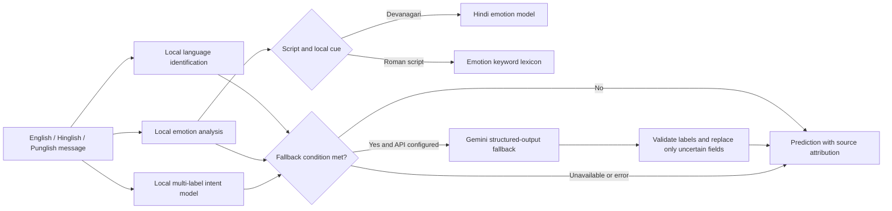

# IndicPulse

IndicPulse is an experimental NLP prototype for analyzing English, Hinglish, and Punglish messages. It combines language identification, emotion recognition, and multi-label intent classification in a local pipeline, with an optional Google Gemini fallback for selected uncertain cases.

The project is a research and demonstration prototype. Its reported metrics come from specific validation and test splits and do not guarantee accuracy on new messages.

## System architecture



The fallback is driven by explicit heuristics, not a general out-of-distribution detector. It can run when the language score is low or closely tied, a Romanized Punjabi cue is detected, an intent score is low or near its threshold, or the local emotion module finds no cue. Gemini responses are constrained to the supported label schema and validated before use. A response replaces only fields marked uncertain; local outputs remain available if Gemini is missing, times out, or fails validation.

## Modules and reported performance

### Language identification

- **Classes:** English, Hinglish, Punglish
- **Dataset:** AI4Bharat IndicCMix
- **Model:** character n-gram TF-IDF with Logistic Regression
- **Reported validation accuracy:** **99.13%**
- **Reported validation macro F1:** **0.9913**

These are results on the project’s validation split, not a guarantee for future messages. The `/status` endpoints report the same validation accuracy.

### Emotion recognition

- **Dataset:** EmoHinD-58K, filtered for the initial single-label baseline
- **Eight baseline classes:** admiration, amusement, anger, annoyance, approval, gratitude, love, neutral
- **Baseline model:** character-level TF-IDF with class-balanced Logistic Regression
- **Reported validation accuracy:** **64.69%**
- **Reported validation macro F1:** **0.6093**

The first baseline excluded multi-label and rare-label examples. In the running application, Devanagari messages can use the Hindi model. Roman-script emotion recognition primarily uses a keyword lexicon; the validation metrics above do not measure that lexicon path. The lexicon can miss emotion expressed through unfamiliar wording, context, or spelling variation.

### Multi-label intent classification

- **Labels:** `Question`, `Request`, `Complaint`, `Opinion`, `Other`
- **Candidate set:** 978 labeled rows in `data/processed/intent_training_candidates.csv`: 580 marked synthetic and 398 existing candidates. Seven reviewed ambiguous examples have empty intent lists and are represented as all-zero labels.
- **Training split:** 684 train / 147 validation / 147 test
- **Model:** fine-tuned `xlm-roberta-base` with multi-label binary cross-entropy loss
- **Training:** 3 epochs; best reported validation loss **0.3186**
- **Reported held-out test micro F1:** **0.7652**
- **Reported held-out test macro F1:** **0.7658**

Per-label thresholds were selected on validation data. The reported test F1 and thresholds are:

| Intent | Threshold | Test F1 |
| --- | ---: | ---: |
| Question | 0.29 | 0.9231 |
| Request | 0.32 | 0.7879 |
| Other | 0.27 | 0.7692 |
| Complaint | 0.34 | 0.6824 |
| Opinion | 0.27 | 0.6667 |

These scores describe one held-out split. The reviewed dataset is small for five overlapping labels and does not establish performance across every language variety or real-world domain.

## Intent annotation guide

- **Question:** asks for information, clarification, or confirmation.
- **Request:** asks someone to perform an action, even when phrased as a question.
- **Complaint:** expresses dissatisfaction about a problem or unmet expectation.
- **Opinion:** expresses an evaluation, preference, or judgment.
- **Other:** a clear communicative purpose outside the four labels above.

Multiple labels are used only when a message independently expresses multiple purposes. A question mark alone does not make an utterance a Question, and a neutral factual report is not automatically a Complaint. See [the annotation guide](docs/intent_annotation_guide.md) for examples and uncertainty rules.

## Web app and API

The recommended server is **FastAPI**, implemented in `src/api_fastapi.py` and started by `run_api.bat`. It serves the interface from `src/static/index.html` and exposes `GET /status` and `POST /predict`.

The separate `app.py` entry point is a legacy standard-library HTTP server. It serves `public/index.html` and compatibility routes such as `/api/predict`. Both use port 8000 by default, so run only one server at a time.

### Setup

```powershell
python -m venv .venv
.\.venv\Scripts\Activate.ps1
pip install -r requirements.txt
```

FastAPI is included in `requirements.txt` for the recommended server.

### Local data and model files

Datasets and trained model artifacts are excluded from Git by `.gitignore`. A fresh clone therefore needs the local artifacts before the full pipeline can start: `models/language_tfidf_logreg.joblib` and `models/intent-xlmr-final/`. The emotion model file, `models/emotion_tfidf_logreg.joblib`, is needed for the Devanagari Hindi emotion-model path; without it, that path is unavailable. Training scripts also require the corresponding local datasets and processed splits described in `data/README.md`.

### Start the FastAPI app

```powershell
.\run_api.bat
```

Then open `http://127.0.0.1:8000`.

### Start the legacy server

```powershell
python app.py
```

### API example

```http
POST /predict
Content-Type: application/json

{"message":"Mera refund abhi tak nahi aaya, bahut gussa hai."}
```

The response includes predicted language, emotion, intent labels, source attribution, and fallback status. Detailed output includes local language and intent scores and active intent thresholds. Scores are model outputs, not calibrated probabilities.

### Gemini fallback configuration

Set `GEMINI_API_KEY` in a local `.env` file to enable the fallback. The default model is `gemini-3.5-flash-lite`; `GEMINI_MODEL` can override it. Requests use low thinking effort, a 10-second HTTP timeout, and no automatic retries. If Gemini is unavailable, times out, fails, or returns invalid labels, the local predictions remain in the response. Model loading at server startup is separate from the request timeout. Keep `.env` private; it is excluded from Git.

## CLI usage

Analyze one message:

```bash
python scripts/run_pipeline.py --message "Mera refund abhi tak nahi aaya, bahut gussa hai."
```

Start an interactive session:

```bash
python scripts/run_pipeline.py --interactive
```

Run the built-in demo:

```bash
python scripts/run_pipeline.py --demo
```

## Data and attribution

Raw datasets and processed CSV files are excluded from this repository. See [data/README.md](data/README.md) for the data policy and source fields.

- **IndicCMix:** AI4Bharat, used for English, Hinglish, and Punglish language identification.
- **EmoHinD-58K:** `debadityashome/emohi58k-finegrained-hindi-emotion-datatext` on Hugging Face, used for the Hindi emotion baseline.
- **MASSIVE:** Amazon Alexa / Amazon Science, CC BY 4.0. The repository includes exploratory intent-data preparation utilities; MASSIVE is not used in the current fine-tuned intent training split.
- **EmoInHindi:** Singh et al., LREC 2022. Restricted to research use and not redistributed in this repository.

## Limitations and next steps

- Grow and independently review representative intent examples, especially for Hinglish and Romanized Punjabi.
- Evaluate by language variety and per-label precision, recall, and F1 on a separate human-reviewed test set.
- Improve Roman-script emotion recognition beyond keyword matching and measure it separately from the Devanagari Hindi model.
- Revisit thresholds only after measuring changes on held-out data.
- Explore other Indic code-mixed varieties, such as Bengali-English or Tamil-English, as future work.

Transformer-based emotion models and higher F1 targets are possible research directions, not completed work or promised outcomes.
